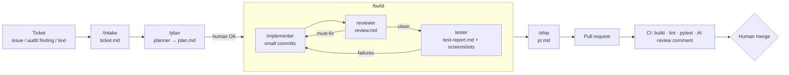

# The TraceLayer AI harness

The harness is a shared process on top of your own AI setup. It doesn't replace your setup.
You keep your own prompts, tools and habits. The harness adds four shared roles, four commands, three skills
and a folder per task, so anyone can see how a change was planned, built, reviewed and tested.

## How to use it with your own tools

| You use | Do this |
|---|---|
| **Claude Code** | Run `/intake <issue>`, then `/plan <id>`, `/build <id>` and `/ship <id>`. The subagents and skills load from `.claude/`. |
| **Devin** | Give it the ticket and say: *"Follow AGENTS.md and docs/harness/playbooks/run-a-task-in-devin.md."* It writes the same `docs/plans/<id>/` files and opens a PR, and CI does the rest. |
| **Argo Helm / Cursor / anything else** | Point it at `AGENTS.md`. For each role, paste the matching `.claude/agents/<role>.md` as the instructions. They're plain markdown. |
| **No agent** | The playbooks work as checklists for a human too. |

Start with one playbook from `playbooks/`. You don't need the rest to begin.

## What each file is for

| File | Purpose |
|---|---|
| `AGENTS.md` | Source of truth: repo map, how to run and test, conventions, definition of done |
| `CLAUDE.md` | Points Claude Code to AGENTS.md, plus Claude-only notes |
| `.claude/agents/planner.md` | Ticket → `plan.md` (goal, scope, steps, risks, test plan). Asks before guessing. |
| `.claude/agents/implementer.md` | Follows the plan, commits each step, runs the tests after each one |
| `.claude/agents/reviewer.md` | Reads the diff as a skeptic → `review.md` (must-fix and nice-to-have). Never edits code. |
| `.claude/agents/tester.md` | Adds tests, runs the suites and the UI check → `test-report.md` |
| `.claude/commands/{intake,plan,build,ship}.md` | The four steps of the flow, as slash commands |
| `.claude/skills/api-endpoint` | How a route is built here: auth, tenancy, schemas, tests |
| `.claude/skills/ui-check` | Run the app and screenshot desktop and mobile with Playwright device profiles |
| `.claude/skills/security-check` | Secrets, tenancy leaks, authz and log hygiene, using the audit report as the reference |
| `docs/decisions/` | ADRs. `0000-template.md` to copy, `0001-ai-harness.md` for this setup |
| `docs/plans/<id>/` | One folder per task, with all of its artifacts |
| `.github/workflows/ci.yml` | Build, lint and **AI review** (posts the reviewer checklist on the PR) |
| `.github/workflows/test.yml` | Backend pytest against Postgres, plus frontend typecheck |
| `docs/harness/playbooks/` | Short, copy-paste guides for common tasks |
| `docs/harness/demo-run.md` | The first real run, step by step |

## CI secret

The AI review job reads the repo secret **`ANTHROPIC_API_KEY`**. Add it under Settings → Secrets and variables → Actions.
Without it, the job prints a notice and skips, and the PR doesn't fail. The job doesn't run on PRs from forks.
