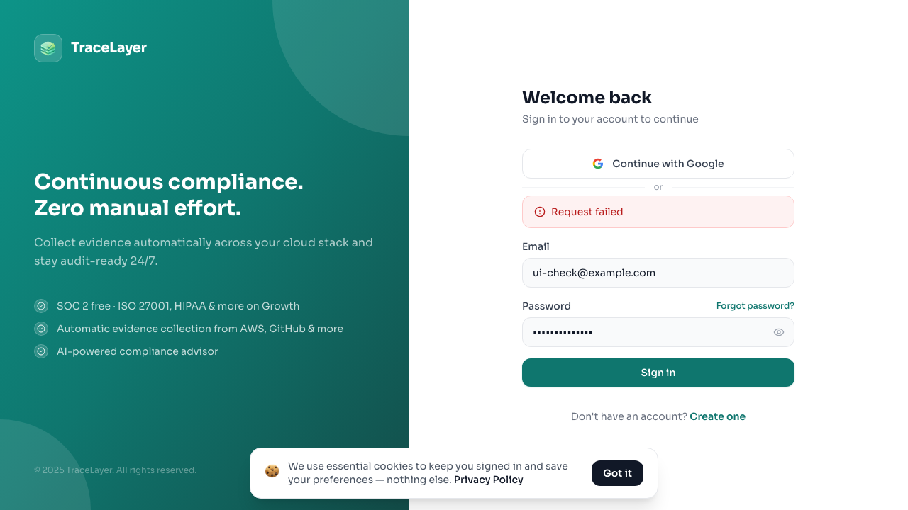
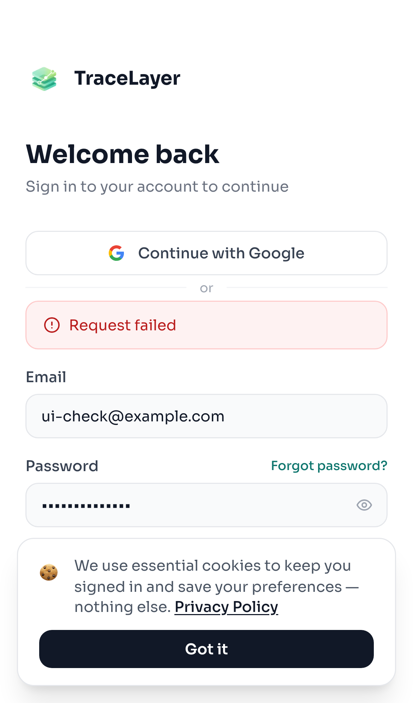
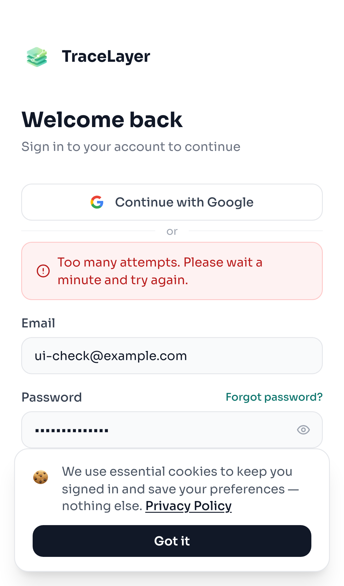

# Ship: tl-f001-rate-limit-logging

## Definition of done (AGENTS.md)
- [x] Tests green: backend `pytest` 78 passed. Frontend `tsc` passes (no frontend code changed).
- [x] Lint clean: `ruff check .` (0.4.10, CI pin)
- [x] New behaviour tested (7 tests in `backend/tests/test_rate_limit.py`). UI change screenshotted on desktop and mobile.
- [x] Docs updated: `docs/RUNBOOK.md`, "Rate-Limit Events"
- [x] `ticket.md`, `plan.md`, `review.md` and `test-report.md` are present. ADR: none needed (plan → Decision record).
- [x] Reviewer: clean after 2 rounds

## Summary
429 responses from the rate limiter now write one structured `rate_limit_exceeded` log record with the route
template, method, limit, client IP, and the tenant (`company_id`/`user_id`) when the request has a verified access
token. This remediates audit finding TL-F001. The 429 body now carries a human `detail`, so a user locked out of
login sees "Too many attempts. Please wait a minute and try again." instead of "Request failed".

## Changelog
- Rate-limited requests now show a clear "Too many attempts" message, and 429 events are logged with tenant and endpoint for security investigations (TL-F001).

## PR description

**Also on this branch:**
- The AI harness itself (`AGENTS.md`, `.claude/`, `docs/harness/`, `docs/decisions/`, the CI AI review job). See `docs/harness/README.md`.
- A baseline fix that makes `main`'s CI green:
  - JSONB `server_default`s broke `create_all`, so all tests errored;
  - unpinned ruff reported 2,500+ errors;
  - the frontend build needs `RESEND_API_KEY`.

**What:** a custom `RateLimitExceeded` handler in `backend/core/limiter.py` replaces slowapi's default
(`backend/main.py`).
- Log: `rate_limit_exceeded {"route", "method", "limit", "client_ip", "company_id", "user_id"}`. Tenant fields come
  only from a signature- and expiry-verified `type: access` token. The record never includes the header, token,
  query string, body or email.
- Body: `{"detail": "...", "error": "Rate limit exceeded: <limit>"}`. `error` is kept for backward compatibility.
- `Retry-After` header: the seconds left in the window, falling back to the limit period.

**Why:** audit finding TL-F001 (Medium), "rate-limit events lack per-tenant structured logging". The frontend reads
`detail`, so it showed "Request failed" on 429s.

**How it was tested:** [test-report.md](test-report.md). Seven new tests, each checked against a deliberately broken copy of the code by the reviewer.
Desktop and mobile Playwright check of the login page against a dev backend:

| | Desktop | Mobile |
|---|---|---|
| Before |  |  |
| After |  |  |

**What the review caught:** [review.md](review.md).
- Round 1, must-fix: no test proved the production app used the new handler, so reverting `main.py` would have left
  every test green. Fixed with a wiring test.
- Two nice-to-haves fixed: the `Retry-After` test couldn't detect a broken window calculation, and the runbook said one
  log line per 429 when there are two.
- Round 2: clean.

**Not in this PR (follow-ups):**
- The 2FA `totp_token` is a full `type: access` token (`auth.py:137`).
- Client IP behind Railway's proxy: uvicorn runs without `--forwarded-allow-ips`, so the IP, and the per-IP limit key, is probably the proxy's.
- The "wait a minute" text assumes per-minute limits.

## Command (run when you're ready)
```bash
gh pr create --base main --head chore/ai-harness \
  --title "AI harness + TL-F001: tenant-aware rate-limit logging" \
  --body-file docs/plans/tl-f001-rate-limit-logging/pr.md
```
