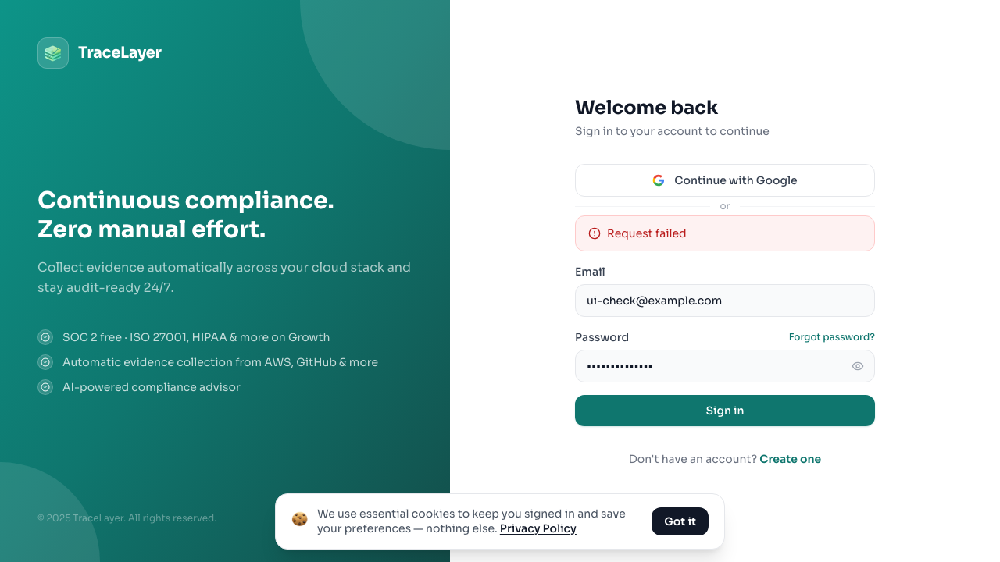
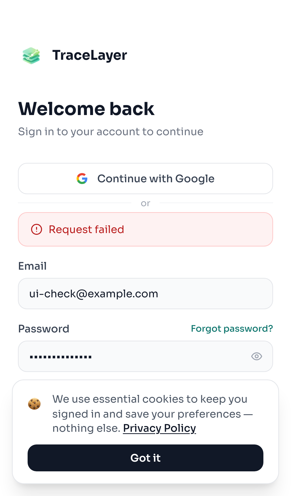
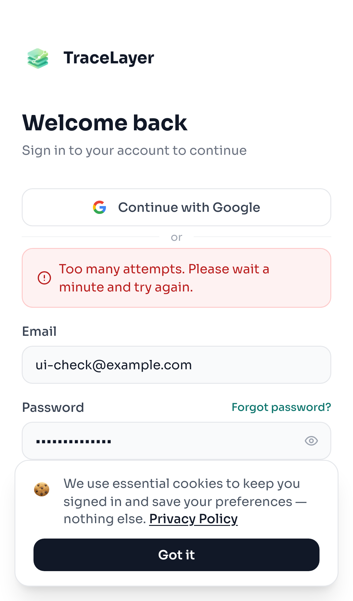

# Test report: tl-f001-rate-limit-logging

Tested at `d5ad0f1` on `chore/ai-harness`, 2026-11-19. Reviewer verdict before testing: clean (round 2).

## Commands and results

| Command | Result |
|---|---|
| `cd backend && pytest tests/ -q` (Postgres test DB, `APP_ENV=test`) | **78 passed**, 0 failed, 0 skipped (23.9 s) |
| `cd backend && ruff check .` (ruff 0.4.10, CI pin) | **All checks passed** |
| `cd frontend && npx tsc --noEmit` | **Pass**, exit 0, no errors |
| `cd frontend && npm run build` | Not run. No frontend code changed (plan: optional) |
| `node screenshots/check.mjs` against a dev backend with `APP_ENV=development` (limits on) | Desktop and mobile both got **429**, no horizontal overflow |
| `curl -i -X POST /v1/auth/login` after the budget was used up | `429`, `retry-after: 30`, body `{detail, error}` (see below) |

## Tests

I added no new tests. `backend/tests/test_rate_limit.py` (written by the implementer and checked by the reviewer
with mutation runs) already covers every test item in the ticket:

| Test | What it proves |
|---|---|
| `test_anonymous_429_logs_route_template` | One `rate_limit_exceeded` record per 429. `route` is the template `/v1/things/{thing_id}`, not `/v1/things/123`. It also has method, limit and client IP, with `company_id`/`user_id` set to `None`. The message JSON matches the structured `extra`. |
| `test_authenticated_429_logs_tenant` | A valid access token gives the matching `company_id` and `user_id`. The token isn't in the log. |
| `test_untrusted_token_is_not_logged_as_tenant` [wrong-key, expired, wrong-type, garbage] | Forged, expired, refresh-type and malformed tokens are not trusted, so both tenant fields are `None`. The log has no token, no email and no query string (`email=`). |
| `test_429_response_body_and_retry_after` | Status 429, human `detail`, `error` kept, and `Retry-After` is an integer from 1 to 60. |
| `test_retry_after_uses_time_left_in_window` | `Retry-After` is the time left in the window (about 15 s after 45 s), not a fixed 60. |
| `test_retry_after_falls_back_to_limit_period` | If the window-stats lookup fails, `Retry-After` falls back to the limit period (60). |
| `test_production_app_uses_custom_429_handler` | `main.app` actually registers the new handler, so reverting `main.py` would fail. |

## UI check (`ui-check` skill)

The setup was a sandboxed dev backend (`APP_ENV=development`, throwaway DB, dummy secrets) on :8765 and the Next.js dev
server on :3456. `check.mjs` sends 10 failed logins for `ui-check@example.com` to use up the 10/minute per-IP budget.
It then submits the login form once per Playwright device profile (`Desktop Chrome`, `iPhone 13`). The `before-*`
screenshots were taken the same way from the pre-change commit `376659a`.

| | Before (`376659a`) | After (`d5ad0f1`) |
|---|---|---|
| Desktop |  |  |
| Mobile (iPhone 13) |  |  |

- `before-desktop.png`: the login error banner says only "Request failed" after the 429.
- `before-mobile.png`: the same "Request failed" banner on iPhone 13.
- `after-desktop.png`: the banner says "Too many attempts. Please wait a minute and try again." It wraps to two lines inside the form column and is easy to read.
- `after-mobile.png`: the same message on iPhone 13. It wraps to two lines in the full-width banner, with no sideways overflow (`scrollWidth <= innerWidth`).

Other observations:
- **Console errors:** each context logs 3. Two show up on a plain page load with no form submit: the CSP blocks
  `va.vercel-scripts.com/.../script.debug.js` (Vercel Analytics and Speed Insights debug scripts). These have nothing
  to do with this change. The third is Chrome's own `Failed to load resource: ... 429 (Too Many Requests)` network
  line, which is the expected result of the request. The app throws no errors of its own.
- **Tap targets:** the Sign in button is 342×40 px on mobile and 384×40 px on desktop. This change doesn't touch it.
  It's a little under the 44 pt iOS guideline, but it was like that before.
- The cookie banner covers the bottom of the form on mobile in both the before and after shots. That was already
  the case and isn't caused by this change.

## Log record from the live run

Each 429 in the dev backend log has exactly one matching record. There were 5 `429 Too Many Requests` access lines
and 5 `rate_limit_exceeded` lines: 2 from `check.mjs`, 2 from a console diagnostic and 1 from `curl`. Here is one of them:

```
2026-11-19 09:39:55,780 WARNING core.limiter rate_limit_exceeded {"route": "/v1/auth/login", "method": "POST", "limit": "10 per 1 minute", "client_ip": "127.0.0.1", "company_id": null, "user_id": null}
```

The route is the template, and the tenant fields are `null` because login requests have no token. Searching the
whole log for `example.com`, `password`, `bearer` and `eyJ` (case-insensitive) found **0** matches. As the runbook
says, slowapi's own `WARNING slowapi ratelimit 10 per 1 minute (127.0.0.1) exceeded at endpoint: /v1/auth/login`
line comes just before each record.

Live 429 response:

```
HTTP/1.1 429 Too Many Requests
retry-after: 30
content-type: application/json

{"detail":"Too many attempts. Please wait a minute and try again.","error":"Rate limit exceeded: 10 per 1 minute"}
```

## Acceptance criteria

| Criterion | Status | Evidence |
|---|---|---|
| One `rate_limit_exceeded` record per 429, with route template, method, limit, client IP, and `company_id`/`user_id` from a **valid** token (else `null`) | Met | `test_anonymous_429_logs_route_template`, `test_authenticated_429_logs_tenant`; live log: 5 × 429 ↔ 5 records, route `/v1/auth/login` |
| Log never contains tokens, passwords, emails or request bodies | Met | `test_untrusted_token_is_not_logged_as_tenant` (4 cases), `test_authenticated_429_logs_tenant`; live log grep: 0 matches |
| 429 body has a human `detail`, keeps `error`; `Retry-After` no worse than today | Met | `test_429_response_body_and_retry_after`, both `Retry-After` tests; live `curl` shows `detail`, `error`, `retry-after: 30` (before: no header) |
| Login page shows the message on desktop and mobile | Met | `after-desktop.png`, `after-mobile.png` against `before-*` |
| Tests cover anonymous log fields, authenticated tenant fields, forged token, response body | Met | Tests above. Also covered: production wiring and the `Retry-After` window and fallback |

## Not tested

- **Authenticated 429 against the live server.** All 7 limited routes are in `api/v1/auth.py` and are normally
  called without a session, so the tenant fields were only shown to be filled in by the unit test, not in the live
  run.
- **Client IP behind Railway's proxy.** This is out of scope (see `plan.md` Follow-ups). Locally `client_ip` is
  `127.0.0.1`.
- **`npm run build`.** No frontend files changed.
